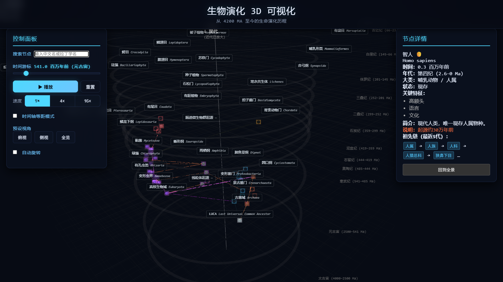

# 🌱 生物演化 3D · 可漫游的生命之树

把 42 亿年的生命史做成一张**能点、能播放、能一镜漫游**的三维图谱。
纯前端、**离线可跑**：双击 `index.html` 就能用，不需要服务器、不需要联网。


## 一、它长什么样

- **1397 个类群 / 1396 条亲缘关系**，全部带中文名（缺失的用拉丁名音译并标注「音译」）
- 按 **15 个地质年代**分层排布，早期类群聚在中心，越晚近的层越大 —— 从俯视角度看是一圈圈向外生长的年轮
- **漫游模式**：镜头沿时间轴自下而上一层层升，节点逐个弹出、连线逐段爬行，左下角有年代 HUD（如「365 Ma · 泥盆纪 · 90%」）
- **播放模式**：拖时间轴让生命史「生长」出来，1× / 4× / 16× 可切
- **点击节点**：高亮完整祖先链与后代，右侧面板给出分类、首现年代、上位类群



## 二、快速开始

**方式一（最简单）**：双击 `index.html`。所有依赖都在 `vendor/`，`file://` 下直接跑。

**方式二（本地服务器）**：

```bash
双击 启动.bat
# 或
python tools/serve.py            # 默认 127.0.0.1:8777
python tools/serve.py --port 9000 --no-browser
```

**URL 参数**

| 参数 | 作用 |
|---|---|
| `?autotour=1` | 打开即自动开始漫游（录屏用） |
| `?tourspeed=0.245` | 临时覆盖漫游速度（值越小越慢，默认 `TOUR_SPEED_SCALE`） |

## 三、数据从哪来（重要）

| 来源 | 用途 | 说明 |
|---|---|---|
| [Open Tree of Life 3.6](https://opentreeoflife.org/) | 分类框架、亲缘关系 | 从全量 4,528,293 个节点中抽样得到 1397 个类群的子树 |
| [Paleobiology Database](https://paleobiodb.org/) | 首现年代 | 有化石记录的直接取实测值；没有的按上位类群推断，并在节点 `evidence` 字段标注来源 |
| iNaturalist / 人工整理 | 中文名 | 优先权威中文名；缺失者用拉丁名音译，前端标注「音译」 |

- **不要把这里的年代当作学术引用**：约六成节点的年代是推断值（`inherit` / `bound`），只有一部分来自 PBDB 实测。
- **音译名不是正式中文名**，仅作读法参考。
- 数据许可请以两个数据库官网的条款为准；本仓库的 MIT 许可只覆盖**代码**。

## 四、技术要点

- three.js r128（UMD，随仓库分发），纯静态页面，无构建步骤
- **批渲染**：1400+ 节点压成 5 个 `InstancedMesh`（按几何档位分桶），连线合成 1 个 `LineSegments` + 1 个箭头 `InstancedMesh` → 整场景 **12 个 draw call**
- **布局**：锥形分层（半径由时代序号驱动，`320 → 2700`），层内按大类做扇区划分 + 确定性松弛（`mulberry32` 固定种子，刷新后布局不变）
- **漫游**：镜头高度/FOV 按已显现节点的实测半径自适应，并对半径、高度、居中位移分别做指数平滑，避免新节点冒出时镜头跳动
- **显隐策略**：当前层及其之前的所有层显示、之后的层隐藏；历史层按距离逐级压暗
- **性能**：节点标签用 CSS2DRenderer 分帧创建（每帧 140 个），DPR 上限 1.5，避免首屏被 DOM 阻塞

## 五、目录结构

```
index.html            入口
css/style.css         样式
js/data7.js           数据（1397 节点 / 1396 边）
js/layout.js          布局：锥形分层 + 扇区 + 松弛
js/app.js             场景、批渲染、时间轴、漫游
js/ui.js              面板、搜索、筛选、HUD
vendor/               three.js r128 + OrbitControls + CSS2DRenderer
tools/serve.py        本地静态服务器
docs/                 封面与截图
```

## 六、已知限制

- **类群覆盖偏“大纲”**：全部是科/目/纲/门级，没有物种级节点；最近 6600 万年只有约 100 个节点，结尾偏薄
- 中文名有 35 个缺失（显示为拉丁名）
- 年代约六成为推断值，不能当学术数据引用
- 漫游总时长约 4 分 20 秒（`js/app.js` 顶部 `TOUR_SPEED_SCALE` 可调）

## 七、致谢

- 分层可视化的视觉思路参考了 **polytech-tree**（其源码不在本仓库内）
- 三维渲染依赖 [three.js](https://threejs.org/)（MIT）
- 视频版使用的背景音乐为 Scott Buckley 作品（CC BY 4.0），**音乐文件不随仓库分发**

## License

代码：[MIT](LICENSE)。数据：遵循 Open Tree of Life / PBDB 各自的条款。
